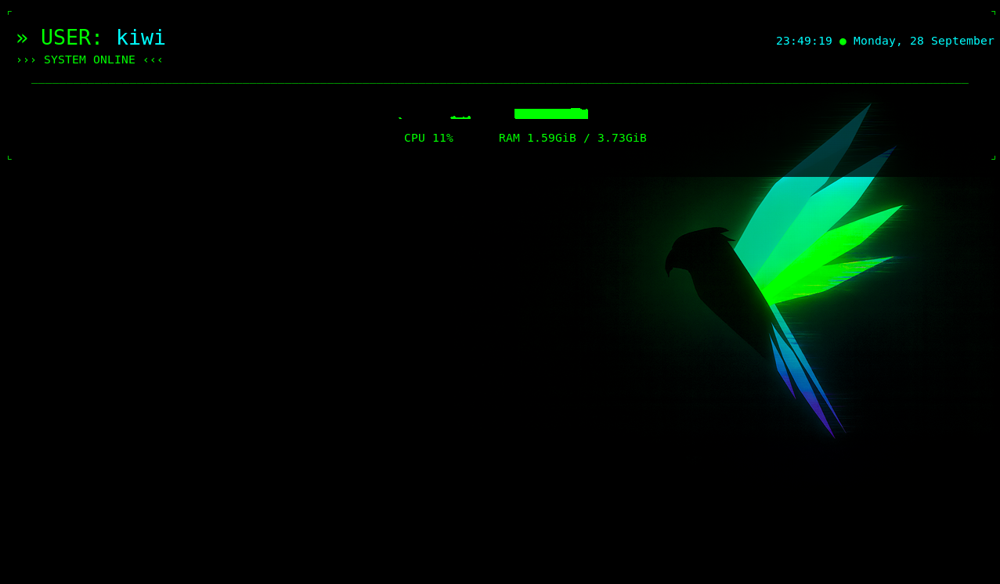

# Cyber deck Theme

Up-cycling an old MacBook Pro to a custom cyber deck! 
In this project I built my own custom retro cyber deck Theme. 

PS: This project has been fully adapted to the hardware, operating system and the graphic environment of my old MacBook Pro. 
Therefore the configurations and code in this repository may most likely not work as expected on other computers unless you 
happen to have a similar setup.  

## Inspiration 

While scrolling on social media on a hot summer day I came across a video, which sparked my interest for this project. 
I saw a mini Laptop that could fit in a pocket! 

"How is that possible?!" 

I thought as I became more and more interested and soon I found myself going down a rabbit hole of electronics,
programming, python, databases, networking, cybersecurity etc... 

It was very overwhelming. I felt the need to learn all of those topics ASAP. But knowing that wasn't realistic I got 
discouraged and felt unmotivated. I didn't know where to begin, nor how to begin. 

Now after a lot of thinking I've decided to just go for it. 

It might not be the ideal path or the perfect roadmap into computer science and 
electronics, but doing nothing isn't going to get me anywhere either. 

So let's see how it ends!

## Learning approach 
I am using Claude to support me throughout this project. The main reason is simple: My lack of knowledge in this 
area, I still have a lot to learn. 

I don't want to simply copy the code and paste it, that is not the goal of this project. Instead I asked Claude 
to give me step by step instructions so that I can question the code, understand it and then apply it myself. 

My goal is to eventually be able to build projects based on my own ideas, thinking and creativity. 
For now I must make mistakes, break things, fix them and learn from the process. 

## Current Status

🚧 this project is currently a work in progress 🚧

### What's working: 
  - Changed the colors of the Terminal
  - Made the first part of the retro HUD (the top)
    
### Still working on:
  - currently focused on finishing the retro HUD

## Purpose 

I intend to use this cyber deck as my personal test lab. 
The Computer I am working with is a 2012 MacBook Pro (currently running parrot home). Its capabilities are limited, with 
4 GB of RAM (which I want to upgrade to 8GB). That means I cannot run heavy programs or perform demanding tests on this machine. 
But it is capable of many other things! Some of the things I want to use it for
Include:

  - Practicing Linux command
  - Ethical hacking and CTFs
  - Running Pi-hole
  - Building a small homelab
  - Learning how the network works
  - Experimenting with SSH and other network tools
  - and much more!
    
(honestly I also think it look really cool and makes great decoration :3) 

## Setup 

I'm working with two Computers:

1. The future Cyber Deck
2. My workstation (where I write the code)

I've decided to code on one computer and push/pull to the other. In that way I cannot only practice my Git Version Control 
skills but also my organization skills. 

## Do it you it yourself

If you would like to try this out here is a [simple guide](guide/guide.md)

